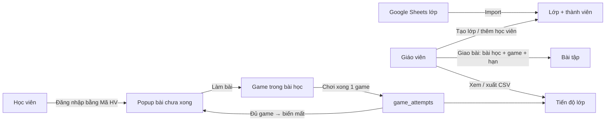

# Đặc tả: Lớp học, giao bài tập & thông báo bài tập (WeWIN Cambridge)

> Thiết kế lại từ bản chung `feature-spec-homework-generic.md` cho cấu trúc bài học, cách chấm điểm và hạ tầng của web này (NestJS + TypeORM + Next.js).
>
> Thuật ngữ trên web này:
> - **Unit / Week**: một dòng `game_units` (vd. `super-kids-week-3`), thuộc một sách (`bookType`: `super-kids`, `kids`, `starter`, `mover`, `flyer`).
> - **Bài học (lesson)**: một `part` trong unit (vd. `lesson-1`). Unit không chia part thì dùng `partId = 'default'`.
> - **Game**: một trong 5 hoạt động của bài học: `flip`, `speak`, `memory`, `ordering`, `scramble`.
> - **Bài tập**: giáo viên giao **một bài học** (mặc định gồm cả 5 game) hoặc chỉ một số game trong bài học đó, kèm hạn nộp.

Thông báo vẫn chỉ là **popup trong web** khi học viên vào trang. Chưa có email, Zalo hay push notification.

---

## 0. Khác biệt so với bản chung

| Bản chung | Web này | Hệ quả thiết kế |
|---|---|---|
| Hoạt động = 1 bài có số câu cố định | Bài học = 1 part gồm 5 game | Giao theo **bài học**, có thể chọn bớt game |
| Điểm = đúng / tổng × 10 | Mỗi game tính **điểm tốc độ**: tối đa 100 điểm/câu (Flip: 10 điểm/thẻ), làm xong khi đúng hết | Ghi thêm `maxScore`, điểm /10 = `score / maxScore × 10` |
| Có sẵn bảng "bản ghi hoàn thành" | `game_progress` chỉ lưu cờ true/false, không có thời điểm; `game_score` chỉ lưu điểm cao nhất | **Thêm bảng `game_attempts`** (mỗi lần chơi xong là một dòng) |
| Học viên = user đăng nhập | Kết quả game gắn với **Mã HV** (`playerId`), chơi không cần đăng nhập | Lớp lưu `user_id`, đối chiếu kết quả qua `user.username = playerId` |
| Lớp tạo tay | Danh sách lớp + Mã HV đã có trong Google Sheets (mỗi sheet `WeWIN01__CLASS__WWxxxxx` là một lớp) | Thêm **script import lớp từ Drive**, vẫn giữ tạo/sửa tay |
| Next.js Route Handlers + Prisma | NestJS + TypeORM, Next.js chỉ làm UI | API viết ở backend NestJS; migration TypeORM chạy tay trên Neon |
| i18n vi/en | Chưa có i18n, UI hardcode tiếng Việt | Popup viết tiếng Việt, không thêm i18n |

---

## 1. Danh sách tính năng

### Phía giáo viên / admin (trang `/class` trong khu quản lý, thay cho dữ liệu mock hiện tại)

1. Tạo, sửa tên, xóa lớp; tìm kiếm và phân trang danh sách lớp phía server.
2. **Import lớp từ Google Drive**: mỗi sheet là một lớp, cột "Mã HV" là thành viên. Chạy lại import thì chỉ thêm học viên mới, không xóa ai.
3. Thêm nhiều học viên vào lớp cùng lúc (tìm theo **Mã HV hoặc họ tên**, chọn nhiều dạng chip) và gỡ học viên. Một học viên có thể ở nhiều lớp.
4. Giao nhiều bài trong một lần. Mỗi dòng gồm **Sách → Unit/Week → Bài học → (tuỳ chọn) chọn game** và **hạn nộp**. Mặc định giao cả 5 game, hạn = bây giờ + 7 ngày.
5. Xem danh sách bài đã giao, **sửa hạn nộp**, xóa bài.
6. Bảng tiến độ theo bài × học viên: số game đã xong / số game được giao, điểm /10, số lần làm, thời gian nộp (xanh nếu đúng hạn, đỏ nếu trễ). Bấm vào ô để xem điểm từng game.
7. Xuất tiến độ ra CSV.
8. Nhật ký thao tác (audit log): ai giao bài gì, sửa hạn khi nào, cho lớp nào.

### Phía học viên

1. Khi vào web, nếu còn bài chưa xong thì hiện popup "Chào {tên}, bạn có N bài chưa hoàn thành". Áp dụng cho cả học viên **đăng nhập bằng Mã HV** lẫn học viên **vào bằng link `?sid=` từ web báo bài hoặc nhập Mã HV ở khu trò chơi** (không đăng nhập).
2. Popup chia hai nhóm: **Đã quá hạn** (đỏ, đứng trước) và **Sắp đến hạn**. Trong mỗi nhóm, bài có hạn gần nhất đứng trên.
3. Mỗi bài hiện: tên lớp, tên bài học (vd. "WeWIN Super Kids · Week 3 · Lesson 1"), tiến độ `2/5 game`, hạn nộp; bài giao trong 24 giờ qua có badge **"Mới"**.
4. Nút **"Làm bài"** dẫn thẳng vào bài học (`/games/<sách>/<slug>/<partId>`); nếu chỉ giao 1 game thì vào thẳng game đó.
5. Nút × ẩn popup **đến hết ngày** (giờ Việt Nam). Làm xong đủ game thì bài tự biến mất khỏi popup.

---

## 2. Luồng nghiệp vụ



### 2.1. Giao bài

1. Giáo viên mở lớp, thêm các dòng: chọn bài học (`unitSlug` + `partId`), tuỳ chọn tập game, hạn nộp.
2. Server kiểm tra từng dòng: unit tồn tại và `isActive`, `partId` có trong `parts` của unit (hoặc `'default'` khi unit không có part), các game nằm trong `enabledGames` của part, hạn nộp hợp lệ.
3. Server tạo tất cả bài trong **một transaction** (`dataSource.transaction`): một dòng lỗi thì không tạo dòng nào.
4. Server lưu **snapshot**: tên sách, tên unit, tên bài học, `bookType` (để dựng link) — unit có đổi tên thì bài cũ vẫn hiển thị đúng.
5. Server ghi audit log.

> Lưu ý: `docs/super-kids/HUONG_DAN_THEM_WEEK.md` đã quy định **không đổi slug** của unit. Bài tập tham chiếu unit bằng `unitSlug` nên càng phải giữ quy định này. Nếu seed xóa một unit đang được giao, bài tập vẫn hiện bằng snapshot nhưng nút "Làm bài" bị ẩn.

### 2.2. Ghi kết quả mỗi lần chơi (điểm nối với nội dung bài học)

Hiện `UnitGameScreen.handleGameComplete` gọi `POST /leaderboard/submit` mỗi khi chơi xong một game (kể cả chơi lại). Mở rộng như sau:

- Frontend gửi thêm `maxScore` (và `itemCount`) cho game vừa chơi:

  | Game | `score` hiện tại | `maxScore` |
  |---|---|---|
  | `flip` | số thẻ đã lật × 10 | số từ × 10 |
  | `memory` | tổng điểm cặp (100/cặp, trừ khi lật thừa) | số cặp × 100 |
  | `speak`, `scramble` | tổng điểm tốc độ (≤ 100/từ) | số từ × 100 |
  | `ordering` | tổng điểm tốc độ (≤ 100/câu) | số câu × 100 |

- Backend, trong cùng request, ngoài việc cập nhật `game_score` / `monthly_game_score` như cũ, **chèn thêm một dòng `game_attempts`** (append-only, không upsert).
- Request cũ không có `maxScore` vẫn được nhận; dòng attempt đó có `maxScore = null` (tính là "đã làm" nhưng không có điểm /10).

### 2.3. Xác định "đã làm bài" (phần cốt lõi)

Một bài tập gồm tập game `G` (mặc định cả 5). Với mỗi học viên:

- Một game `g` được tính là **xong** khi có ít nhất một attempt trùng `(playerId, unitSlug, partId, g)` và được tạo **sau thời điểm giao bài**. Chơi trước khi giao thì không tính.
- Bài tập **xong** khi tất cả game trong `G` đều xong. Còn thiếu thì trạng thái là `in_progress` (vd. 3/5).
- **Điểm game** lấy từ lần chơi tốt nhất: `round(score / maxScore × 100) / 10` (thang 10, 1 chữ số thập phân).
- **Điểm bài tập** = trung bình điểm các game đã xong (chỉ hiện khi bài đã xong; đang làm thì hiện điểm tạm).
- **Thời gian nộp** = thời điểm game cuối cùng được hoàn thành lần đầu, tức `max` của "attempt sớm nhất" của từng game. Trễ hạn khi thời điểm này sau hạn. Chơi lại sau hạn để nâng điểm không làm bài bị tính trễ.
- Bảng tiến độ của giáo viên và popup của học viên **dùng chung một hàm thuần** để luôn khớp nhau.

Giả mã:

```ts
// attempts: game_attempts của (playerId, unitSlug, partId), createdAt >= assignment.createdAt
for g of assignment.gameTypes:
  list = attempts.filter(a => a.gameType === g)
  if list rỗng → games[g] = { status: 'pending' }
  else
    best   = phần tử có (score / maxScore) lớn nhất (hòa → bản ghi sớm nhất; maxScore null → điểm null)
    first  = phần tử có createdAt nhỏ nhất
    games[g] = { status: 'done', score10: best ? round(best.score / best.maxScore * 100) / 10 : null,
                 attemptCount: list.length, firstDoneAt: first.createdAt }

doneGames = games có status 'done'
status      = doneGames.length === G.length ? 'done' : doneGames.length > 0 ? 'in_progress' : 'pending'
score10     = trung bình score10 (bỏ null) của doneGames
submittedAt = status === 'done' ? max(firstDoneAt) : null
isLate      = submittedAt !== null && submittedAt > deadlineAt

→ { status, doneCount: doneGames.length, totalCount: G.length, score10,
    attemptCount: tổng attempts, submittedAt, isLate, games }
```

### 2.4. Thông báo cho học viên (dạng pull)

Có hai cách nhận diện học viên, dùng chung một hàm tính và một dạng response:

| Học viên | Nhận diện | Gọi API |
|---|---|---|
| Đăng nhập (NextAuth, `username` = Mã HV, role `STUDENT`) | Access token | `GET /homework/incomplete` (JWT) |
| Không đăng nhập: vào bằng `?sid=` (`StudentSsoHydrator`) hoặc nhập Mã HV (`PlayerIdModal`) | `playerId` trong `useStudentStore` | `GET /homework/incomplete/by-player?playerId=` (công khai) |

1. Client tải trang → ưu tiên session đăng nhập; không có thì lấy `playerId` từ `useStudentStore`; không có cả hai (khách) thì không làm gì.
2. Server quy ra Mã HV (từ `sub` của JWT → `user.username`, hoặc từ `playerId`, so sánh không phân biệt hoa thường) → tài khoản `user` có `username` đó → các lớp học viên đang thuộc → bài tập của những lớp đó (bỏ lớp `isActive = false`).
3. Server lấy toàn bộ attempt liên quan bằng **một query** (`playerId` + danh sách `(unitSlug, partId)`, `createdAt >= min(assignment.createdAt)`), rồi ghép trong bộ nhớ để tránh N+1.
4. Server chỉ trả về bài chưa xong, kèm `isOverdue`, `isNew`, tiến độ, link; sắp xếp quá hạn trước, rồi theo hạn tăng dần.
5. Client hiển thị popup. Nếu đã đóng trong ngày (`localStorage`, key `homework-dismissed:<playerId>:<YYYY-MM-DD theo giờ VN>`) thì không gọi API và không hiện.

Popup gắn ở `frontend/app/layout.tsx` (cạnh `StudentSsoHydrator`) và phải chờ `StudentSsoHydrator` xử lý xong `?sid=` rồi mới đọc `playerId`. Session đăng nhập là giáo viên/admin thì không hiện popup.

**Endpoint công khai `by-player`**: hiện Mã HV là "chìa khóa" duy nhất của khu trò chơi (`/students/verify`, `/students/ensure`, `/leaderboard/submit` đều công khai), nên endpoint này không làm lộ thêm nhiều. Để giữ mức lộ tối thiểu:
- Không trả `displayName` (client đã có tên trong `useStudentStore`); chỉ trả tên lớp, tên bài học, hạn, tiến độ, link.
- Không trả điểm số.
- Giới hạn tần suất theo IP (vd. 30 request/phút) để chống dò Mã HV hàng loạt.
- Khi web báo bài chuyển sang link có ký (token HMAC như `portal-sso.ts` đang dùng cho `/parent/weekly-scores`), đổi endpoint này sang nhận token thay vì `playerId` trần.

Response mẫu:

```json
{
  "success": true,
  "displayName": "Nguyễn Văn A",
  "count": 2,
  "overdueCount": 1,
  "upcomingCount": 1,
  "items": [
    {
      "assignmentId": "...",
      "className": "WW00192",
      "title": "WeWIN Super Kids · Week 3 · Lesson 1",
      "doneCount": 2,
      "totalCount": 5,
      "deadlineAt": "2026-11-05T10:00:00.000Z",
      "deadlineDisplay": "05/11/2026 17:00",
      "isOverdue": true,
      "isNew": false,
      "href": "/games/super-kids/super-kids-week-3/lesson-1"
    }
  ]
}
```

`href` dựng bằng `BOOK_TYPE_TO_ROUTE` (`frontend/lib/games/bookRoutes.ts`): `/games/<route>/<unitSlug>/<partId>`, thêm `/<game>` nếu chỉ giao một game. Server trả `bookType`/`unitSlug`/`partId`/`gameTypes`, client tự dựng link để không lặp bảng ánh xạ ở backend.

### 2.5. Import lớp từ Google Drive

1. Mở rộng `backend/scripts/fetch-drive-students.ts`: ngoài danh sách học viên, xuất thêm `drive-classes.json` gồm `{ classCode: 'WW00192', title: <dòng tiêu đề sheet, vd. "IELTS INTENSIVE - Hồ Quốc Khánh + ...">, folder: '' | 'XVNT', members: [Mã HV] }`. Học viên ở nhiều sheet thì có mặt ở nhiều lớp.
2. Script `import-classes.ts` (`--dry-run`, `--env .env.neon`): upsert lớp theo `code`, thêm thành viên còn thiếu (chỉ những Mã HV đã có tài khoản `user`), không gỡ ai; in danh sách Mã HV không tìm thấy tài khoản.
3. Lớp trong thư mục `XVNT` được import **như lớp bình thường** (`isActive = true`); `description` ghi thêm thư mục nguồn để giáo viên nhận ra.

---

## 3. Phân quyền

| Vai trò | Nhận diện trên web này | Quyền |
|---|---|---|
| Admin | role `ADMIN` trong `roles` | Quản lý mọi lớp, xem audit log |
| Giáo viên | `user.role = 1` hoặc role `TEACHER` | Quản lý lớp, giao bài, xem tiến độ |
| Học viên | `user.role = 0`, có `username` (Mã HV) | Không vào trang quản trị; chỉ thấy bài của lớp mình qua popup |

- API quản trị dùng `JwtAuthGuard` + `RolesGuard` + `@Roles('TEACHER', 'ADMIN')` (guard đã có sẵn ở `backend/src/auth/roles.guard.ts` nhưng chưa route nào dùng). Trả **403** khi sai vai trò, **404** khi lớp/bài không tồn tại hoặc không thuộc lớp.
- Frontend: trang `/class` đã nằm trong `proxy.ts` (bắt buộc đăng nhập); thêm kiểm tra `hasRole(TEACHER | ADMIN)` giống `app/(management)/user/page.tsx`. Thêm mục "Lớp học" vào `management-sidebar.tsx`.
- Chỉ user có `role = 0` và có `username` mới được thêm vào lớp (server kiểm tra lại).
- User `isActive = false` và unit `isActive = false` bị loại khỏi tìm kiếm, danh sách thành viên, catalog và popup.
- Giáo viên và admin đều **thấy và quản lý tất cả các lớp**; không phân lớp theo giáo viên.
- Lưu ý an toàn: `POST /leaderboard/submit` hiện **công khai**, ai biết Mã HV cũng gửi được điểm hộ. Bài tập dựa trên dữ liệu này nên có cùng mức tin cậy với bảng xếp hạng hiện tại. Nếu cần chặt hơn: khi request có access token thì ghi `userId` vào attempt và chỉ tính attempt có `userId` khớp.

---

## 4. Mô hình dữ liệu

Tất cả entity mới kế thừa `BaseEntity` (`is_active`, `create_at`, `update_at`, `delete_at`) như các bảng hiện có.

| Bảng | Trường chính |
|---|---|
| `classes` | id (uuid), code (unique, vd. `WW00192`, nullable khi tạo tay), name, description (dòng tiêu đề sheet), source (`manual` \| `drive`), created_by (FK user, nullable) |
| `class_members` | class_id, user_id, added_at; unique (class_id, user_id) |
| `class_assignments` | class_id, book_type, unit_slug, part_id, game_types (`simple-array`), snapshot: book_name, unit_name, part_title; deadline_at (timestamptz, UTC), created_by, create_at |
| `game_attempts` | id, player_id (varchar 50), student_id (FK `student`, nullable), user_id (nullable), unit_slug, part_id, game_type, book_type, score (int), max_score (int, nullable), item_count (int, nullable), created_at |
| `class_audit_logs` | action (`assign` \| `update_deadline` \| `delete_assignment` \| `add_members` \| `remove_member` \| `import`), actor_id, class_id, assignment_id, snapshot, old/new deadline, created_at |

Index gợi ý:
- `class_assignments (class_id, deadline_at)`
- `class_members (user_id)`
- `game_attempts (player_id, unit_slug, part_id, game_type, created_at)`

Xóa lớp thì cascade xóa thành viên và bài tập của lớp, **không** đụng tới tài khoản, `game_attempts`, `game_progress`, `game_score`.

Đối chiếu học viên ↔ kết quả: `class_members.user_id → user.username` (Mã HV) `= game_attempts.player_id`, so sánh **không phân biệt hoa thường** (dữ liệu Drive có cả `WEWIN01-HV-1713` và `WeWIN01-HV-1713`). Nên chuẩn hóa `player_id` khi ghi attempt: tìm `student.playerId` hoặc `user.username` khớp `LOWER(...)` và lưu đúng dạng đó.

---

## 5. API (backend NestJS)

| Method & Path | Mô tả |
|---|---|
| `GET /classes?q=&page=&limit=` | Danh sách lớp (tìm theo mã/tên, phân trang server) |
| `POST /classes` | Tạo lớp |
| `GET /classes/:id` | Chi tiết lớp: thành viên + bài đã giao |
| `PATCH /classes/:id` | Sửa tên / mô tả / `isActive` |
| `DELETE /classes/:id` | Xóa lớp |
| `POST /classes/:id/members` | Thêm nhiều học viên `{ userIds: [] }` |
| `DELETE /classes/:id/members/:userId` | Gỡ học viên |
| `GET /classes/students?q=&excludeClassId=` | Tìm học viên (Mã HV / họ tên) cho bộ chọn |
| `GET /classes/catalog` | Cây chọn bài: sách → unit → bài học → game (đọc từ `game_units`, bỏ unit `isActive = false`) |
| `POST /classes/:id/assignments` | Giao nhiều bài (1 transaction) |
| `PATCH /classes/:id/assignments/:aid` | Sửa hạn nộp |
| `DELETE /classes/:id/assignments/:aid` | Xóa bài |
| `GET /classes/:id/progress` | Tiến độ bài × học viên |
| `GET /classes/:id/export?format=csv` | Xuất CSV |
| `GET /classes/audit-logs?classId=` | (Admin) nhật ký |
| `GET /homework/incomplete` | (Học viên đăng nhập, JWT) bài chưa xong |
| `GET /homework/incomplete/by-player?playerId=` | (Công khai, giới hạn tần suất) bài chưa xong theo Mã HV, không trả tên/điểm |
| `POST /leaderboard/submit` | **Sửa**: nhận thêm `maxScore?`, `itemCount?`; ghi thêm `game_attempts` |

Tất cả DTO mới phải khai báo đủ field vì `ValidationPipe` đang bật `whitelist` + `forbidNonWhitelisted`.

---

## 6. Công nghệ áp dụng

| Hạng mục | Cách làm trên web này |
|---|---|
| Backend | NestJS 11, module mới `ClassModule` (classes, members, assignments, progress, export) và `HomeworkModule` (popup) |
| CSDL | PostgreSQL (Neon) + TypeORM; transaction bằng `dataSource.transaction`, thêm thành viên bằng `insert().orIgnore()` |
| Migration | File mới trong `backend/src/migrations/`. Production tắt `synchronize` và chưa có lệnh chạy migration → thêm script `migration:run` (`typeorm-ts-node-commonjs -d typeorm.config.ts migration:run`) và **chạy tay trên Neon trước khi deploy backend** |
| Xác thực | NextAuth (frontend) → Bearer token → `JwtAuthGuard`; phân quyền bằng `RolesGuard` + `@Roles` |
| Validation | `class-validator` trên DTO; kiểm tra lại unit/part/game ở server |
| Cache tiến độ | Chưa cần (vài chục học viên/lớp, 1 query attempts). Nếu chậm thì cache trong bộ nhớ 60 giây theo `classId`, xóa khi đổi thành viên/bài tập |
| Múi giờ | DB lưu UTC; ô `datetime-local` hiểu là `+07:00` (dùng lại `hoChiMinhLocalToUtc` ở `backend/src/parent/iso-week.ts`); hiển thị bằng `Intl.DateTimeFormat('vi-VN', { timeZone: 'Asia/Ho_Chi_Minh' })` |
| UI quản trị | Theo mẫu `user-management-client.tsx`: `axiosClient`, `ReusableTable`, `Pagination`, `Button`, `StatusBadge`, `confirmPopup`; Tailwind + lucide-react. Thay `frontend/lib/constants/class.ts` (mock) bằng service thật `frontend/services/class.service.ts` |
| Popup học viên | Client component + `localStorage` ẩn đến hết ngày; chuỗi tiếng Việt (web chưa có i18n) |
| Xuất báo cáo | CSV UTF-8 có BOM; ô bắt đầu bằng `=`, `+`, `-`, `@` thêm `'` phía trước (Mã HV dạng `WeWIN-...` không bị ảnh hưởng, nhưng tên/ghi chú thì có thể) |
| Test | Jest (đã cấu hình ở backend): hàm tính tiến độ, tính `maxScore`, CSV, ẩn popup theo ngày |

---

## 7. Thay đổi cần làm ở code hiện có

1. `frontend/app/components/games/*Game.tsx`: `onComplete(score)` → `onComplete(score, maxScore, itemCount)`; mỗi game tự biết số từ/cặp/câu của lượt chơi.
2. `frontend/app/components/games/UnitGameScreen.tsx` (`handleGameComplete`): truyền `maxScore`, `itemCount` vào `leaderboardService.submit`.
3. `backend/src/leaderboard`: DTO submit thêm 2 field tuỳ chọn; service chèn `game_attempts` trong cùng request (lỗi ghi attempt không được làm hỏng việc lưu điểm bảng xếp hạng).
4. `backend/src/auth/auth.service.ts`: payload JWT đã có `sub`; `/homework/incomplete` tra `username` từ `sub`.
5. `frontend/app/(management)/class/*`: bỏ dữ liệu mock, nối API thật; thêm mục sidebar.
6. `backend/scripts/fetch-drive-students.ts` + script mới `import-classes.ts`.

---

## 8. Checklist triển khai

- [ ] Entity + migration: `classes`, `class_members`, `class_assignments`, `game_attempts`, `class_audit_logs`
- [ ] Script `migration:run` và chạy migration trên Neon trước khi deploy
- [ ] Ghi `game_attempts` từ `POST /leaderboard/submit`; frontend gửi `maxScore`, `itemCount`
- [ ] `RolesGuard` cho API quản trị; kiểm tra role ở trang `/class`
- [ ] CRUD lớp, thêm/gỡ nhiều học viên, tìm theo Mã HV/họ tên
- [ ] Import lớp từ Drive (dry-run trước, rồi chạy thật)
- [ ] Catalog sách → unit → bài học → game
- [ ] Giao nhiều bài trong 1 transaction, snapshot tên, sửa hạn, xóa bài
- [ ] Hàm tính tiến độ dùng chung (theo game, điểm lần tốt nhất, giờ nộp = lúc xong game cuối, chỉ tính sau khi giao) + unit test
- [ ] Bảng tiến độ + xuất CSV
- [ ] `GET /homework/incomplete` (JWT) và `GET /homework/incomplete/by-player` (công khai, giới hạn tần suất)
- [ ] Popup cho cả học viên đăng nhập và học viên vào bằng `?sid=` / Mã HV (quá hạn / sắp đến hạn, tiến độ x/5, badge "Mới", ẩn đến hết ngày)
- [ ] Múi giờ thống nhất: lưu UTC, nhập/hiển thị giờ Việt Nam
- [ ] Audit log khi giao bài, sửa hạn, xóa bài, đổi thành viên, import

---

## 9. Quyết định đã chốt

1. **Đơn vị giao bài**: theo bài học, mặc định cả 5 game, giáo viên có thể bỏ bớt game. Không có nút "giao cả week": muốn giao 2 lesson của một week thì thêm 2 dòng trong cùng một lần giao.
2. **Popup cho cả học viên không đăng nhập** (vào bằng `?sid=` hoặc nhập Mã HV): có, qua endpoint công khai `by-player` (mục 2.4).
3. **Lớp trong thư mục XVNT**: import như lớp bình thường.
4. **Phạm vi giáo viên**: giáo viên thấy và quản lý tất cả các lớp, không gán giáo viên cho lớp.
