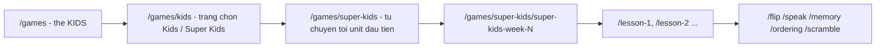

tiêp# Hướng dẫn thêm Week mới cho Super Kids

Tài liệu này dành cho người (hoặc AI) tiếp tục import các Week còn lại của sách
WeWIN Super Kids (`docs/WeWIN_Super_Kids_Split/*.pdf`) vào web game. **Chỉ làm đúng các bước dưới đây, không sửa những phần hệ thống đã có.**

---

## 1. Nguyên tắc quan trọng: CHỈ LÀM TUẦN CHÍNH, BỎ QUA TUẦN REVIEW

> [!IMPORTANT]
> **QUY TẮC BỎ QUA TUẦN REVIEW (ÔN TẬP)**
> 
> Trong giáo trình WeWIN Super Kids, mỗi chủ đề gồm **2 tuần**:
> 1. **Tuần học mới (Main Week - tuần lẻ)**: Giới thiệu bộ từ vựng mới hoàn toàn (Lesson 1 & Lesson 2).
> 2. **Tuần ôn tập (Review Week - tuần chẵn)**: Lặp lại gần như 100% từ vựng của tuần trước đó (chỉ đổi thứ tự hoặc ghép hội thoại).
> 
> 👉 **Khi đưa lên Web Game:** Vì các minigame từ vựng (Flip, Speak, Memory, Ordering, Scramble) sẽ bị trùng lặp trải nghiệm gây nhàm chán cho học sinh, **TUYỆT ĐỐI KHÔNG TẠO CÁC TUẦN REVIEW**.
> 
> - **CHỈ TẠO**: Các tuần có nội dung bài học từ vựng mới chính.
> - **BỎ QUA**: Mọi tuần / trang có tiêu đề `(REVIEW)` hoặc các trang Worksheet, Fun Worksheet, Game vẽ/tô màu trên sách giấy.

### Bảng tra cứu tiến độ toàn bộ giáo trình (Part 1 -> Part 4: Hoàn thành 25 Main Units)

| Tuần trong sách | Tên chủ đề | Part PDF | Trạng thái Web | Số lượng từ vựng |
| :--- | :--- | :---: | :---: | :--- |
| **Week 1** | Countries Around the World | Part 1 | ✅ Hoàn thành | 11 từ |
| **Week 3** | The Solar System | Part 1 | ✅ Hoàn thành | 10 từ |
| **Week 5** | Things in My House | Part 1 | ✅ Hoàn thành | 10 từ |
| **Week 7** | Things in the Bathroom | Part 1 | ✅ Hoàn thành | 10 từ |
| **Week 9** | Emotions | Part 1 | ✅ Hoàn thành | 10 từ |
| **Week 11** | Land Sports | Part 1 | ✅ Hoàn thành | 8 từ |
| **Week 13** | Aquatic Sports | Part 1 | ✅ Hoàn thành | 8 từ |
| **Week 15** | Opposites | Part 2 | ✅ Hoàn thành | 12 từ |
| **Week 17** | Christmas | Part 2 | ✅ Hoàn thành | 10 từ |
| **Week 19** | Jobs and Places | Part 2 | ✅ Hoàn thành | 10 từ |
| **Week 21** | Action Verbs | Part 2 | ✅ Hoàn thành | 8 từ |
| **Week 23** | Positions | Part 2 | ✅ Hoàn thành | 9 từ |
| **Week 25** | Zodiac Animals | Part 2 | ✅ Hoàn thành | 12 từ |
| **Week 27** | Vegetables | Part 3 | ✅ Hoàn thành | 8 từ |
| **Week 29** | More Vegetables | Part 3 | ✅ Hoàn thành | 10 từ |
| **Week 31** | Fruits | Part 3 | ✅ Hoàn thành | 10 từ |
| **Week 33** | Vietnamese Fruits | Part 3 | ✅ Hoàn thành | 10 từ |
| **Week 35** | Drinks | Part 3 | ✅ Hoàn thành | 10 từ |
| **Week 37** | Meals | Part 3 | ✅ Hoàn thành | 8 từ |
| **Week 39** | Illness | Part 3 | ✅ Hoàn thành | 8 từ |
| **Week 41** | Technology | Part 4 | ✅ Hoàn thành | 8 từ |
| **Week 43** | Disasters | Part 4 | ✅ Hoàn thành | 9 từ |
| **Week 45** | New Actions | Part 4 | ✅ Hoàn thành | 8 từ |
| **Week 47** | Inside Us | Part 4 | ✅ Hoàn thành | 8 từ |
| **Week 49** | Toys | Part 4 | ✅ Hoàn thành | 16 từ |

*(Toàn bộ các tuần Review chẵn: Week 2, 4, 6, 8, 10, 12, 14, 16, 18, 20, 22, 24, 26, 28, 30, 32, 34, 36, 38, 40, 42, 44, 46, 48, 50 và các trang Worksheet tô màu được tự động bỏ qua để tránh trùng lặp nội dung).*

---

## 2. Hệ thống hiện tại (đã có sẵn, KHÔNG sửa)



| Thành phần | File | Ghi chú |
| --- | --- | --- |
| Trang chọn Kids / Super Kids | `frontend/app/games/kids/page.tsx` | Dùng ảnh thẻ WebP 860x1024 đồng nhất |
| Route Super Kids | `frontend/app/games/super-kids/**` | Dùng chung `SuperKidsUnitPage.tsx` |
| Màn unit dùng chung | `frontend/app/components/games/SuperKidsUnitPage.tsx` | `breadcrumbBackUrl` PHẢI là `/games/super-kids` (dùng để tạo URL part/game) |
| Bảng tra loại sách | `frontend/lib/games/bookRoutes.ts` | Đã có `super-kids` |
| Không ghi đè icon | `backend/src/game/vocab-icon.helpers.ts` | `super-kids` giữ hình cắt từ sách |
| Script cắt hình | `frontend/scripts/crop_super_kids.py` | Chỉ thêm mục cho các Tuần chính vào `LESSONS` |
| Script seed | `backend/scripts/seed-super-kids.ts` | Chỉ thêm unit của Tuần chính vào `SUPER_KIDS_UNITS` |

Những điều tuyệt đối không làm:
- Không thêm lại redirect `/games/kids` trong `frontend/next.config.ts` (sẽ làm mất trang chọn).
- Không đổi `bookType` khác `super-kids`, không đổi slug của unit đã seed (học sinh đã có tiến độ/điểm theo slug).
- Không sửa các route `games/kids/**` cũ.
- Không đặt hình vào `frontend/public/assets/vocab/...` (đó là thư viện ảnh chung, sẽ lẫn với Kids).

---

## 3. Quy ước đặt tên

| Thứ | Quy ước | Ví dụ |
| --- | --- | --- |
| Slug unit | `super-kids-week-<N>` (giữ đúng số Week trên sách) | `super-kids-week-3` |
| Part (lesson) id | `lesson-<n>` | `lesson-1` |
| Word id | chữ thường, khoảng trắng thành `-`, không dấu | `ice-cream`, `the-moon` |
| Word text | đúng như sách (giữ hoa/thường) | `Ice cream`, `Moon` |
| File hình | `frontend/public/assets/super-kids/week-<N>/<word id>.png` | `week-3/sun.png` |
| File âm thanh (nếu có) | `frontend/public/audio/wewin/super-kids/super-kids-week-<N>/<word id>.mp3` | |

Word id phải giống nhau ở 3 nơi: tên file hình, `id` trong seed, tên file mp3.

---

## 4. Các bước import một Tuần chính

### Bước 1 – Xác định trang của Tuần chính trong PDF
1. Mở file PDF tương ứng trong `docs/WeWIN_Super_Kids_Split/*.pdf`.
2. Tìm trang có phần **"1 LOOK & SAY"** của bài học mới.
3. Kiểm tra tiêu đề: **Nếu có chữ `(REVIEW)` ➔ BỎ QUA**.
4. Số trang trong script là **0-based** (ví dụ trang 3 trong PDF viewer = `page_index=2`).

Liệt kê text nhanh bằng lệnh:
```powershell
python -c "import fitz; d=fitz.open(r'docs/WeWIN_Super_Kids_Split/WeWIN_Super_Kids_v1.0_Part_1_(Trang_1-40).pdf'); [print(i, d[i].get_text()[:120].replace('\n',' | ')) for i in range(d.page_count)]"
```

Ghi lại cho mỗi Lesson: file PDF, `page_index`, tên chủ đề, danh sách từ trong LOOK & SAY **theo thứ tự đọc: từ trái sang phải, hết hàng trên mới tới hàng dưới**.

### Bước 2 – Cắt hình từ vựng
Thêm mục cho Tuần chính vào `LESSONS` trong `frontend/scripts/crop_super_kids.py`:

```python
LessonPage(
    pdf="WeWIN_Super_Kids_v1.0_Part_1_(Trang_1-40).pdf",
    page_index=8,          # 0-based
    week="week-3",
    words=["sun", "moon", "mercury", "venus", "earth"],   # theo thứ tự đọc
),
```

Chạy script cắt hình:
```powershell
python frontend/scripts/crop_super_kids.py
```

Script sẽ tự động:
1. Nhận diện trang raster hoặc vector (render DPI=150 sắc nét).
2. Xóa liên kết "1 LOOK & SAY" nếu chạm mép thẻ viền vàng.
3. Cắt hình vuông 512x512 nền trắng và tách bỏ dòng chữ tên từ ở đáy.

### Bước 3 – Kiểm tra hình bằng mắt (Bắt buộc)
Mở file contact sheet tại `%TEMP%\super_kids_contact_sheet.png` hoặc các file trong `frontend/public/assets/super-kids/week-<N>/`:
- Đúng hình của từ vựng tương ứng.
- Không bị lem viền vàng hay dính thẻ bên cạnh.
- Không bị mất chi tiết hình vẽ.

### Bước 4 – Seed dữ liệu vào cơ sở dữ liệu
Trong `backend/scripts/seed-super-kids.ts`:
1. Khai báo mảng từ vựng của Tuần chính (gồm `id`, `text`, `meaning` tiếng Việt có dấu).
2. Thêm Unit vào cuối mảng `SUPER_KIDS_UNITS`.
3. Chạy lệnh seed:
```powershell
cd backend
npm run seed:super-kids
```

### Bước 5 – Kiểm tra trên trình duyệt
1. Kiểm tra Typecheck:
```powershell
cd frontend; npx tsc --noEmit
cd ../backend; npx tsc --noEmit
```
2. Mở trình duyệt tại `http://localhost:3002/games/super-kids`:
   - Kiểm tra menu chuyển nhanh Unit hiển thị đúng tên chủ đề.
   - Thử các game: Flashcard lật thẻ, Phát âm Speak, Ghi nhớ Memory, Word Scramble.

---

## 5. Checklist bàn giao mỗi Tuần

- [ ] **Đã xác nhận đây là Tuần bài mới, KHÔNG PHẢI tuần Review**.
- [ ] Ghi đủ trang và danh sách từ vựng theo đúng thứ tự đọc (trái qua phải, trên xuống dưới).
- [ ] Script cắt hình xuất đủ file ảnh `512x512` vào đúng thư mục `frontend/public/assets/super-kids/week-<N>/`.
- [ ] Ảnh kiểm tra bằng mắt đạt chuẩn: sắc nét, không viền vàng, không khuyết chi tiết.
- [ ] Đã thêm dữ liệu và dịch nghĩa tiếng Việt đầy đủ trong `backend/scripts/seed-super-kids.ts`.
- [ ] Lệnh `npm run seed:super-kids` chạy thành công không lỗi.
- [ ] Đã test các minigame trên web local chạy mượt mà.
